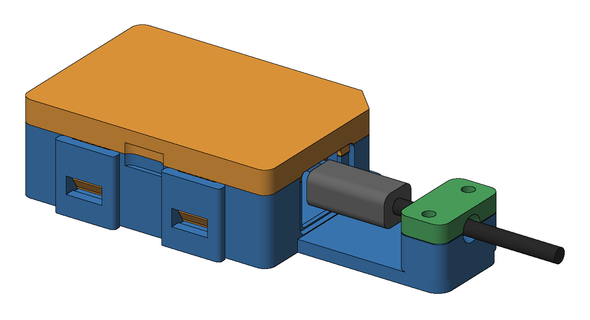
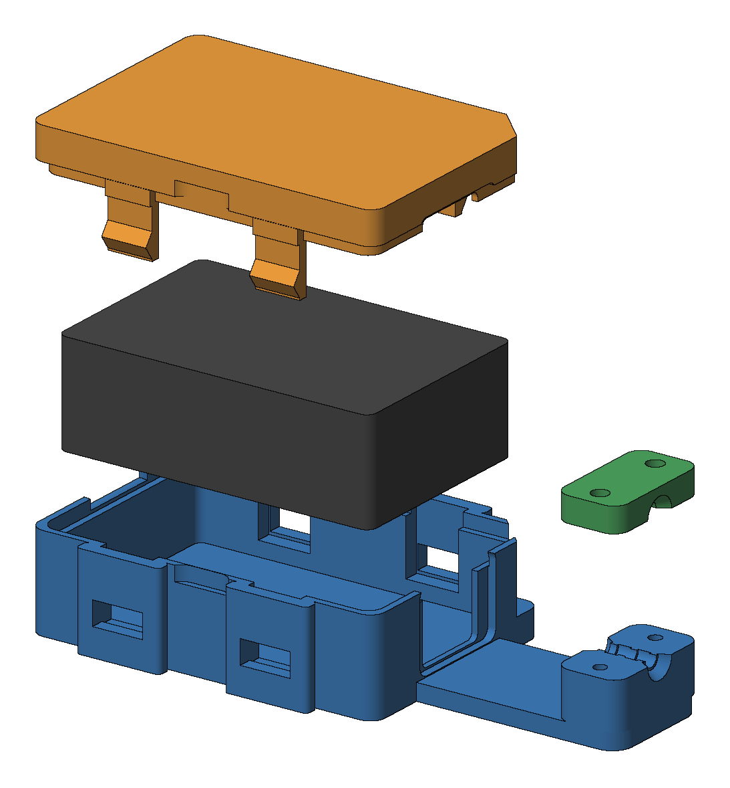
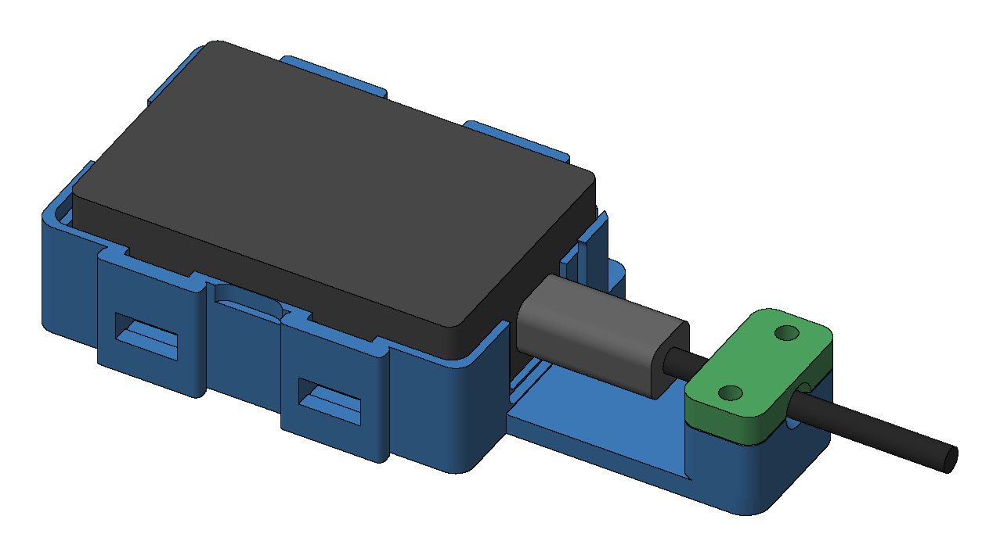
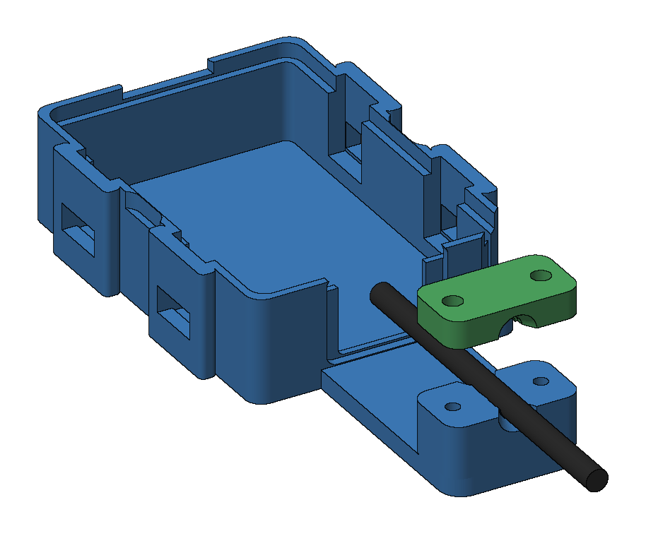
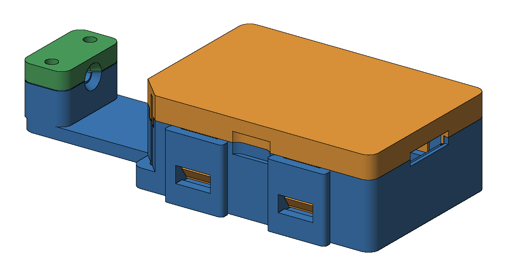

# BLASTERPROOF II

**A 3D-printable strain-relief enclosure for the Intel/Altera USB-Blaster II (Intel FPGA Download Cable II).**



USB-Blaster IIs die young on production benches. Every tug on the USB cable goes through the plug into the receptacle's solder joints, until they crack. BLASTERPROOF II closes the programmer in a snap-fit shell and clamps the cable jacket to a tail on that shell, so bending and pulling loads travel through plastic instead of through the connector.

Part of the **BLASTERPROOF** family. A USB-Blaster III version is planned as `blasterproof-iii`.

## At a glance

| | |
|---|---|
| Parts | Shell, cover, clamp cap: 3 prints, no supports |
| Hardware | 2 × M3: self-tapping screws **or** brass heat-set inserts + thumb screws |
| Material | PETG (default) · ESD-PETG for EPA floors · ASA for hot spots |
| Size | 111.3 × 54.2 × 25.6 mm overall |
| Opens | No tools: four snap clips, release with a paperclip |
| Source | Parametric [CadQuery](https://cadquery.readthedocs.io) model, `cad/cradle_cq.py` |

## Print it

1. Pick **one** shell from `print/`:
   - `shell_selftap`: for 2 × M3 × 12 self-tapping screws. Simplest.
   - `shell_insert`: for 2 × M3 brass heat-set inserts (OD 4.6 × 5.7) + M3 × 10 thumb screws. Tool-free, survives unlimited re-opening.
2. Add `cover` and `clamp_cap`.
3. PETG, 0.2 mm layers, **4 perimeters** (makes the clip arms solid), 25–30 % infill, **no supports**. Files are already oriented for the bed, so don't rotate them.

Full settings per material, assembly steps, the hardware list with purchase links and the QC checklist are in the **[Production Procedure Document](docs/PPD.md)** ([PDF](docs/BLASTERPROOF-II_PPD.pdf)).

## Drawing

[`docs/BLASTERPROOF-II_drawing_1to1_A4.pdf`](docs/BLASTERPROOF-II_drawing_1to1_A4.pdf) is a two-sheet A4 drawing. Sheet 1 is true scale and shows the USB-Blaster II in place. Print it at **100 % / Actual size** and check the 100 mm bar. A correctly printed sheet 1 doubles as a fit template for your programmer.

| | |
|---|---|
|  |  |
|  |  |

## Before you print: measure two things

- **Your USB cable's jacket diameter.** The default `CABLE_D = 4.0` is a typical value, not a measured one.
- **Which USB receptacle your units have.** The opening is sized to clear Type-B, mini-B and micro-B plugs; `USB_PRESET` can tighten it.

Change either in the parameter block at the top of `cad/cradle_cq.py`, then:

```bash
pip install cadquery trimesh manifold3d
cd cad
python cradle_cq.py   # regenerates print/*.stl, print/*.3mf, cad/step/*.step
python verify.py      # interference, clearance and overhang report
```

## Repository layout

```
print/          bed-ready STL + 3MF        (what you slice)
cad/            cradle_cq.py, verify.py
cad/step/       STEP in assembly coordinates (open all parts together in CAD)
docs/           PPD (md + pdf), 1:1 drawing, renders, verification report
tools/          regenerate renders, drawing and PPD PDF
```

To rebuild the documentation after a design change:

```bash
pip install matplotlib shapely pillow markdown pypdf playwright
python tools/render.py && python tools/drawing.py && python tools/build_ppd_pdf.py
```

## Status

Rev **2.2**, see [CHANGELOG](CHANGELOG.md). The geometry has been verified in CAD (zero interference, support-free). Not yet first-article printed in v2.2 form.
